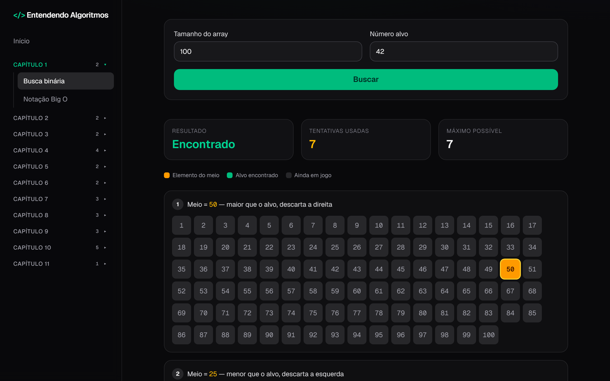
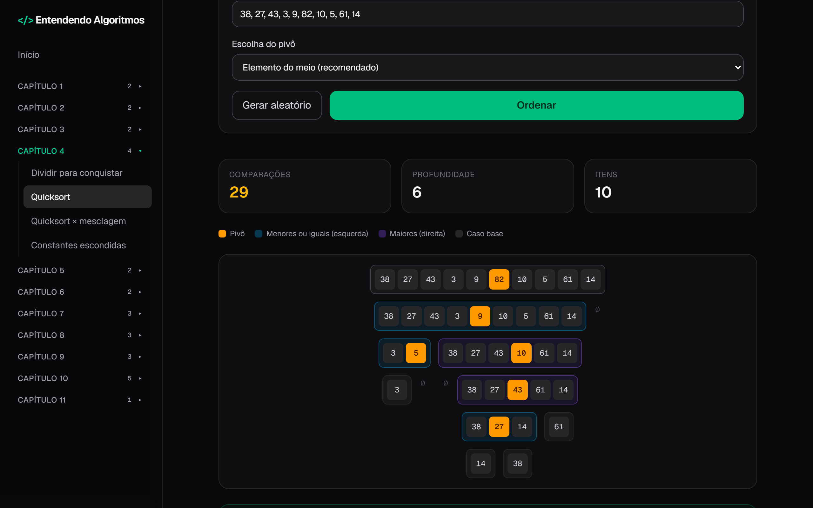
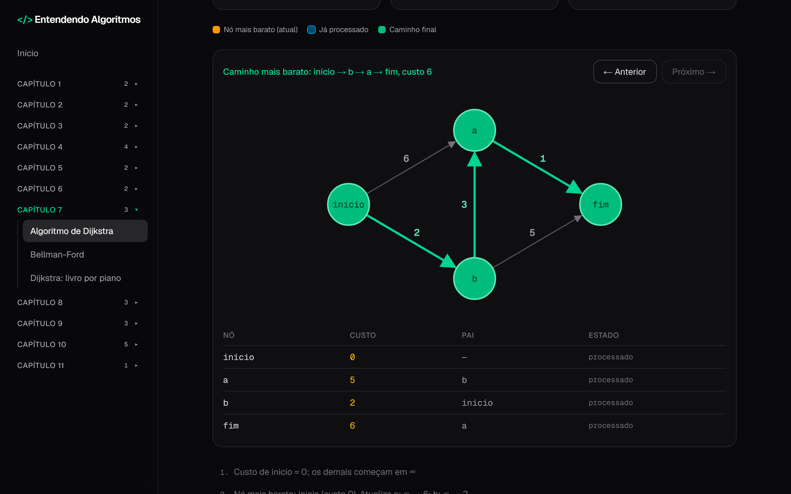
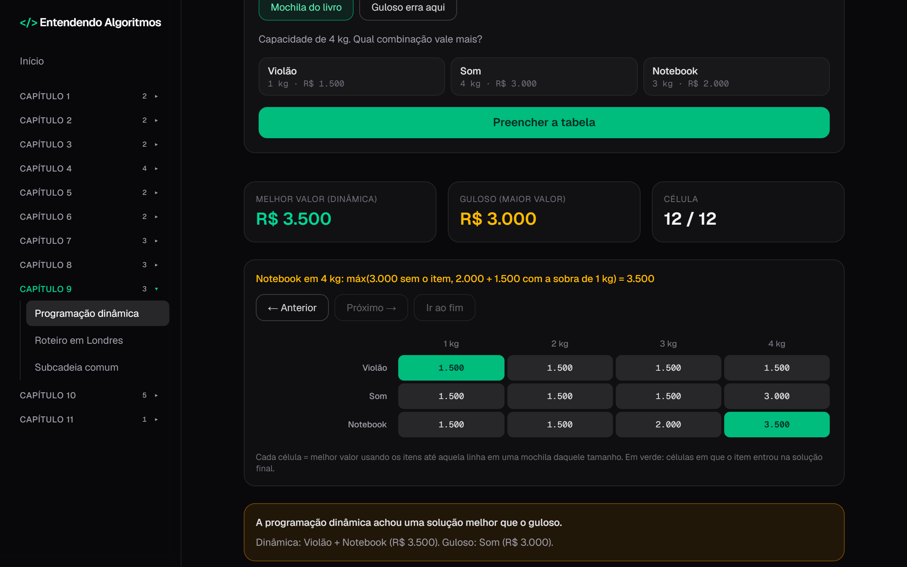
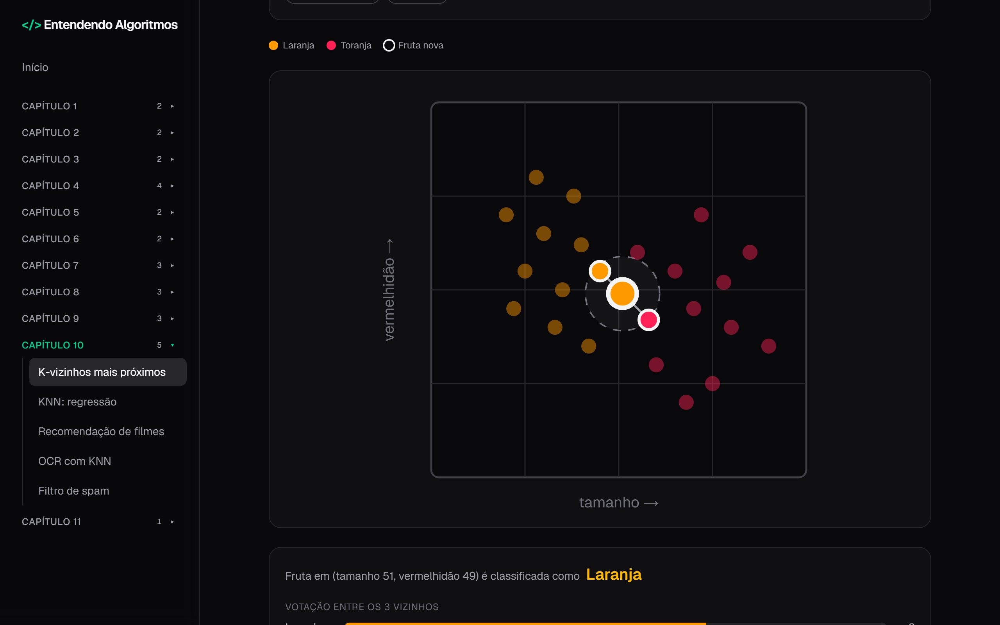
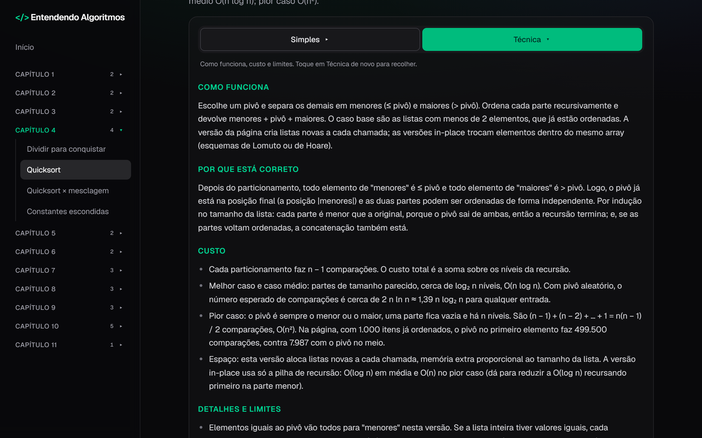
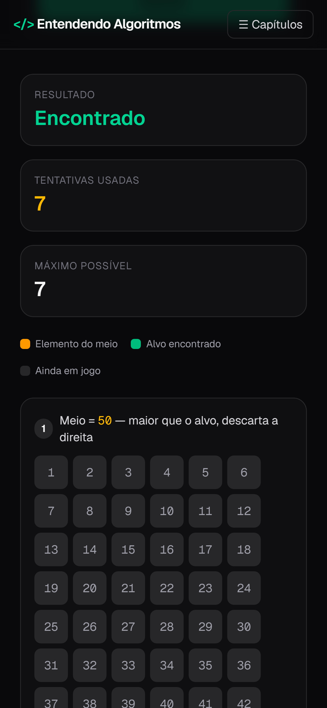
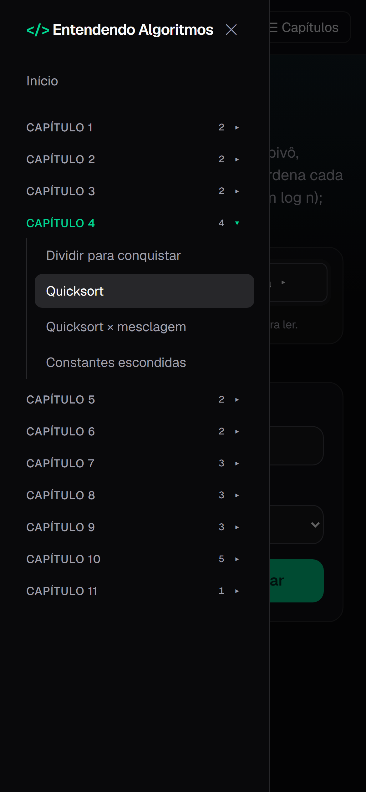

<div align="center">


<br />
<br />

[](https://nextjs.org)
[](https://react.dev)
[](https://www.typescriptlang.org)
[](https://tailwindcss.com)
[](LICENSE)

**Visualizações interativas, passo a passo, para entender como cada algoritmo toma suas decisões.**

[Sobre](#sobre) ·
[Capítulos](#capítulos) ·
[Recursos](#recursos) ·
[Capturas de tela](#capturas-de-tela) ·
[Como rodar](#como-rodar) ·
[Estrutura](#estrutura) ·
[Licença](#licença)

</div>

<br />

## Sobre

**Entendendo Algoritmos** é um app web para **ver** os algoritmos funcionando, em vez de só ler sobre eles. Você digita uma entrada, aperta um botão e acompanha cada decisão: o elemento do meio da busca binária, o pivô do quicksort, a fila da busca em largura, a tabela da programação dinâmica sendo preenchida célula por célula.

O conteúdo segue a ordem dos capítulos do livro *Entendendo Algoritmos* (*Grokking Algorithms*), de Aditya Bhargava, do qual o projeto é inspirado. É um projeto **independente**, sem vínculo com o livro ou com o autor, e **não reproduz o texto do livro**: as explicações, os exemplos e os dados foram escritos para este app.

> [!NOTE]
> Tudo roda no navegador. Não há backend, banco de dados nem conta de usuário: cada algoritmo é uma função pura em TypeScript que devolve o resultado e, quando faz sentido, o registro dos passos, e a página só desenha esse registro.

<br />

## Capítulos

São **11 capítulos** e **29 páginas**, todas com explicação em dois níveis (28 são interativas e uma, a do capítulo 11, é um resumo em texto):

| Cap. | Tema | Páginas |
| :-: | :-- | :-- |
| **1** | Introdução | Busca binária · Notação Big O |
| **2** | Ordenação por seleção | Arrays e listas encadeadas · Ordenação por seleção |
| **3** | Recursão | Recursão (fatorial e pilha de chamadas) · Caixas dentro de caixas |
| **4** | Quicksort | Dividir para conquistar · Quicksort · Quicksort × mesclagem · Constantes escondidas |
| **5** | Tabelas hash | Tabelas hash · Usos da tabela hash (duplicatas e cache) |
| **6** | Busca em largura | Busca em largura · Ordenação topológica |
| **7** | Algoritmo de Dijkstra | Dijkstra · Bellman-Ford · Dijkstra: livro por piano |
| **8** | Algoritmos gulosos | Calendário de aulas · Algoritmo guloso (cobertura de conjuntos) · Caixeiro-viajante |
| **9** | Programação dinâmica | Programação dinâmica (mochila) · Roteiro em Londres · Subcadeia comum |
| **10** | K-vizinhos mais próximos | KNN · KNN: regressão · Recomendação de filmes · OCR com KNN · Filtro de spam (Naive Bayes) |
| **11** | Próximos passos | Resumo dos assuntos para estudar depois |

<br />

## Recursos

<table>
  <tr>
    <td width="50%" valign="top">

### 🎞️ Passo a passo
Os algoritmos mostram o que acontece em cada etapa: boa parte tem **Anterior**, **Próximo** e **Ir ao fim**, uma legenda de cores e uma mensagem explicando a conta feita naquele passo.

### 🧠 Duas explicações por página
Um seletor **Simples** | **Técnica**. A simples usa uma analogia e a intuição; a técnica traz como funciona, por que está correto, o custo (Big O) e os limites. Vem **recolhida**, para a ferramenta ficar à vista.

    </td>
    <td width="50%" valign="top">

### 👩‍💻 Código de cada algoritmo
Trechos enxutos em JavaScript, com botão de copiar, em "Ver o código", logo abaixo da explicação. Eles foram conferidos contra as funções que movem as animações.

### 📱 Feito para o celular também
Menu em gaveta, gráficos que rolam para o lado mantendo o texto legível e botões de tamanho confortável para toque. O menu e as explicações funcionam pelo teclado e usam atributos ARIA.

### 🌗 Tema claro e escuro
Segue a preferência do sistema na primeira visita e tem um botão para trocar, na barra lateral (ou no topo, no celular). A escolha fica salva no navegador.

    </td>
  </tr>
</table>

<br />

## Capturas de tela

<table>
  <tr>
    <td width="50%" align="center">
      
      <br /><sub><b>Busca binária</b>: cada tentativa descarta metade da lista</sub>
    </td>
    <td width="50%" align="center">
      
      <br /><sub><b>Quicksort</b>: a árvore de recursão, com o pivô em cada nível</sub>
    </td>
  </tr>
  <tr>
    <td width="50%" align="center">
      
      <br /><sub><b>Dijkstra</b>: o caminho mais barato e a tabela de custos e pais</sub>
    </td>
    <td width="50%" align="center">
      
      <br /><sub><b>Programação dinâmica</b>: a tabela da mochila, célula por célula</sub>
    </td>
  </tr>
  <tr>
    <td width="50%" align="center">
      
      <br /><sub><b>KNN</b>: clique no gráfico e veja os vizinhos votarem</sub>
    </td>
    <td width="50%" align="center">
      
      <br /><sub><b>Explicação técnica</b>: como funciona, custo e limites</sub>
    </td>
  </tr>
</table>

<div align="center">
<br />

&nbsp;&nbsp;&nbsp;&nbsp;

<br />
<sub><b>No celular</b>: resultado empilhado e menu em gaveta com os capítulos agrupados</sub>
</div>

<br />

## Como rodar

**Requisitos:** [Node.js](https://nodejs.org) 20.9 ou superior e [pnpm](https://pnpm.io).

```bash
git clone https://github.com/diegonatalo/entendendo-algoritmos.git
cd entendendo-algoritmos
pnpm install
pnpm dev
```

Abra <http://localhost:3000>.

| Comando | O que faz |
| :-- | :-- |
| `pnpm dev` | Servidor de desenvolvimento com recarga automática |
| `pnpm build` | Build de produção (gera todas as páginas como estáticas) |
| `pnpm start` | Serve o build de produção |
| `pnpm lint` | Roda o ESLint |
| `npx tsc --noEmit` | Confere os tipos do TypeScript |

<br />

### Compartilhamento (Open Graph)

Cada página tem título, descrição e uma imagem própria nas tags Open Graph e Twitter Card, então o link mostra um cartão ao ser colado em redes sociais e chats. Os endereços absolutos das imagens usam `https://entendendo-algoritmos.vercel.app` (definido em `app/site.ts`). Para publicar em outro domínio, defina a variável ao gerar o build:

```bash
NEXT_PUBLIC_SITE_URL=https://seu-dominio.com pnpm build
```

<br />

## Estrutura

```text
app/
├── <rota>/page.tsx      # uma pasta por página (busca-binaria, quicksort, dijkstra…)
├── components/          # menu lateral, explicação Simples/Técnica, bloco de código, UI comum
├── capitulos.ts         # lista única de páginas: o menu e a home leem daqui
├── codigos/             # trechos de código mostrados nas páginas, um arquivo por capítulo
├── explicacoes/         # textos Simples e Técnico de cada página, um arquivo por capítulo
├── metadata.ts          # título, descrição e tags Open Graph de cada rota, lidos de capitulos.ts
├── og/[slug]/route.tsx  # imagem de compartilhamento (1200×630) de cada página, gerada no build
├── site.ts              # endereço público e nome do site
├── sitemap.ts           # sitemap.xml: a home e as páginas de capitulos.ts
├── robots.ts            # robots.txt: libera tudo e aponta para o sitemap
└── entrada.ts           # leitura e geração das listas de números dos formulários
functions/               # algoritmos puros em TypeScript (devolvem o resultado e cada passo)
@types/                  # tipos dos resultados de cada algoritmo
docs/img/                # banner e capturas de tela deste README
```

<details>
<summary><b>Adicionando um algoritmo novo</b></summary>

<br />

1. **Função:** crie `functions/meuAlgoritmo.ts`, uma função pura que devolve o resultado e uma lista de passos, e os tipos em `@types/meuAlgoritmo.d.ts`.
2. **Página:** crie `app/meu-algoritmo/page.tsx` (use uma página parecida como modelo) para desenhar os passos.
3. **Menu e home:** registre a página em `app/capitulos.ts` com número do capítulo, título, rota e descrição. O menu lateral e os cartões da home são gerados dessa lista.
4. **Conteúdo:** acrescente o texto Simples e o Técnico em `app/explicacoes/capNN.ts` e o trecho de código em `app/codigos/capNN.ts` (do capítulo da página), e use o componente `Explicacao` na página.
5. **Confira:** rode `pnpm lint`, `npx tsc --noEmit` e `pnpm build`.

</details>

<br />

## Sobre o conteúdo

- **Os dados dos exemplos são inventados**: as frutas, os pães da padaria, as notas dos filmes, as mensagens do filtro de spam e as cidades do caixeiro-viajante foram criados para ilustrar, não vêm do livro nem de bases reais.
- **Priorizam clareza**: algumas implementações são deliberadamente simples (por exemplo, a busca em largura usa uma lista no lugar de um `Set`). Os textos técnicos apontam onde o custo real difere do ideal.
- **Conferência**: as explicações e os trechos de código foram escritos com apoio de um assistente de IA ([Claude](https://claude.com/claude-code)) e conferidos por scripts de verificação executados durante o desenvolvimento. **Esses scripts não fazem parte do repositório**, que ainda **não tem testes automatizados**. Se encontrar um erro em alguma explicação, abra uma *issue*.
- **Limitações conhecidas**: os grafos das páginas são fixos (ainda não dá para editar nós e arestas) e não há exercícios com correção automática.

<br />

## Créditos

- Inspirado no livro *Entendendo Algoritmos* (*Grokking Algorithms*), de Aditya Bhargava.
- Construído com [Next.js](https://nextjs.org), [React](https://react.dev), [TypeScript](https://www.typescriptlang.org) e [Tailwind CSS](https://tailwindcss.com).
- Tipografia [Geist](https://vercel.com/font), da Vercel, carregada com `next/font`.

<br />

## Licença

Distribuído sob a licença **MIT**. Veja o arquivo [LICENSE](LICENSE).

<div align="center">
<br />
<sub>Feito para quem aprende melhor vendo as coisas acontecerem.</sub>
</div>
