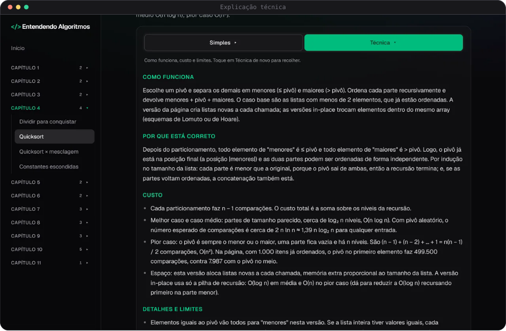
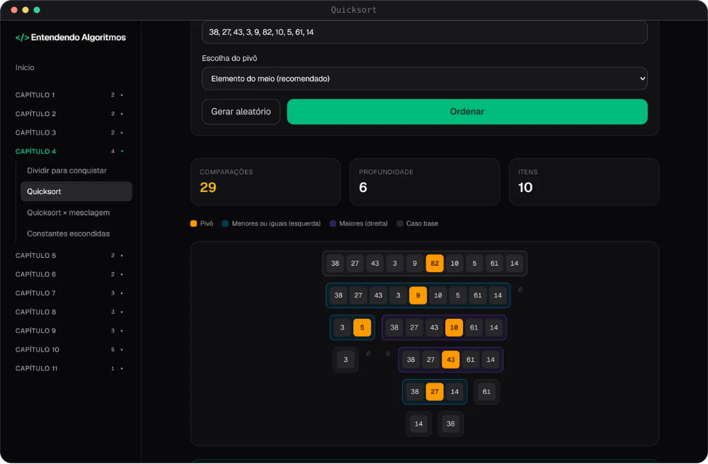
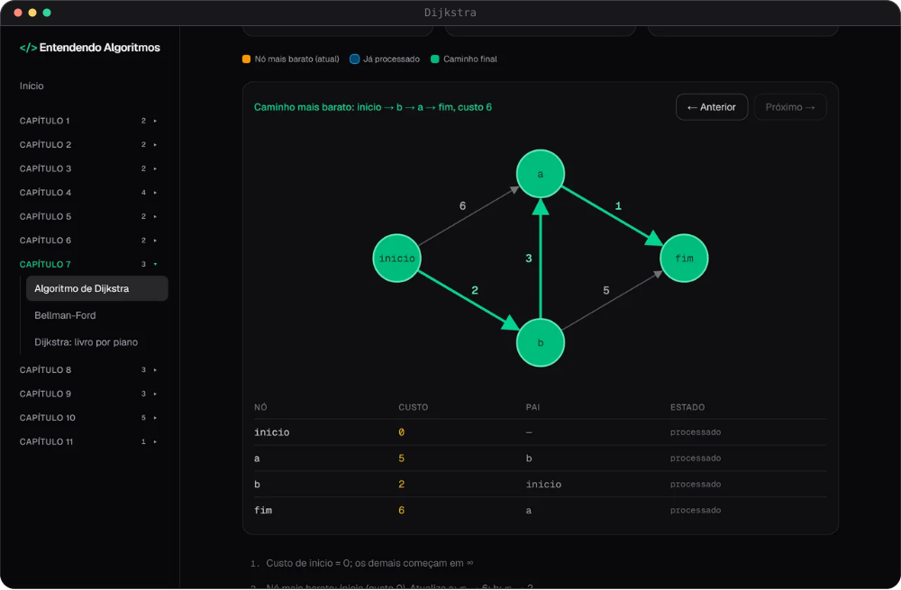
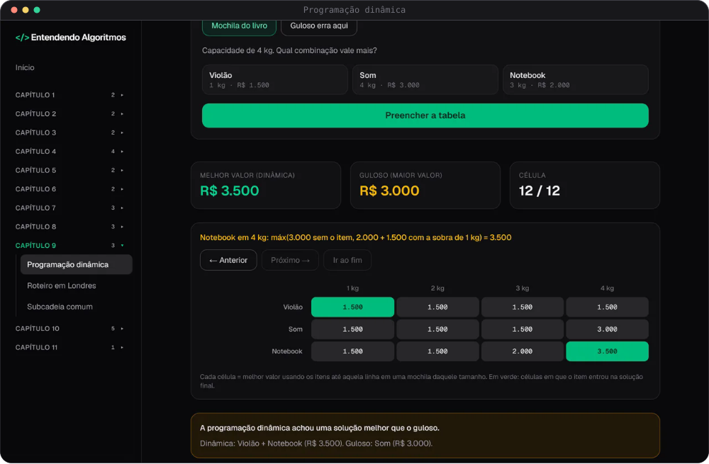
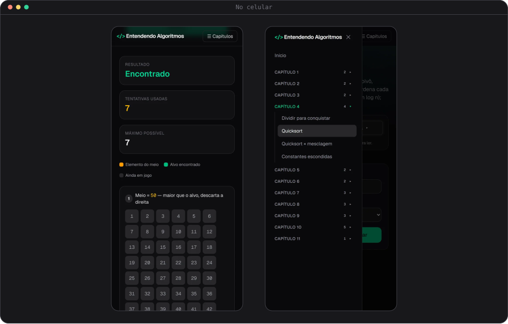
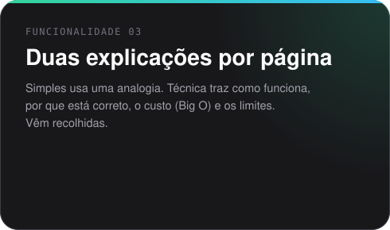
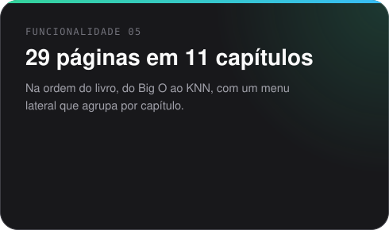
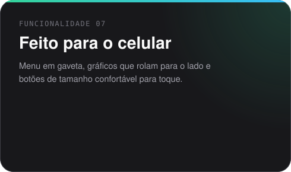
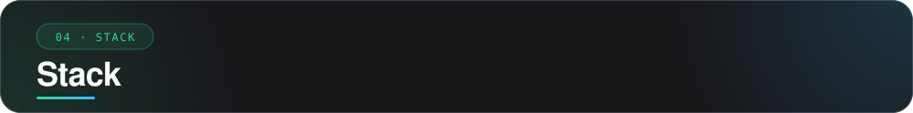

<!-- Arquivo gerado pelo readme-kit. Não edite aqui: altere docs/readme/ e rode "readme-kit build". -->
<div align="center">



<br />

<a href="https://entendendo-algoritmos.vercel.app"></a>
<a href="https://github.com/diegonatalo/entendendo-algoritmos"></a>

<br />


</div>

<br />

<div align="center">


</div>

**Veja os algoritmos acontecendo.**<br />
Visualizações interativas, passo a passo, com explicação simples ou técnica, código para copiar e tema claro ou escuro.

> [!NOTE]
> Projeto independente, inspirado no livro *Entendendo Algoritmos* (*Grokking Algorithms*), de
> Aditya Bhargava. Não tem vínculo com o livro nem com o autor e não reproduz o texto dele.
> Os capítulos 1 a 11 servem só de roteiro: explicações, exemplos e dados foram escritos para o app.

### 📚 Sobre o conteúdo

- **Os dados dos exemplos são inventados.** As frutas, os pães da padaria, as notas dos filmes, as
  mensagens do filtro de spam e as cidades do caixeiro-viajante foram criados para ilustrar.
- **Clareza antes de desempenho.** Algumas implementações são simples de propósito (a busca em
  largura usa uma lista no lugar de um `Set`). Os textos técnicos dizem onde o custo real difere.
- **Feito com apoio de IA.** As explicações e os trechos de código foram escritos com ajuda do
  [Claude](https://claude.com/claude-code) e conferidos por scripts de verificação rodados durante o
  desenvolvimento. Esses scripts **não estão no repositório**. Se achar um erro, abra uma *issue*.

> [!NOTE]
> Limitações conhecidas: o capítulo 11 é só texto, os grafos das páginas são fixos e não há testes
> automatizados nem exercícios com correção.

<br />

<div align="center">


</div>

<div align="center">


<br />
<sub><b>Explicação técnica</b>: como funciona, custo e limites.</sub>

<br />


<br />
<sub><b>Quicksort</b>: a árvore de recursão, com o pivô em cada nível.</sub>

<br />


<br />
<sub><b>Dijkstra</b>: o caminho mais barato e a tabela de custos.</sub>

<br />


<br />
<sub><b>Programação dinâmica</b>: a tabela da mochila, célula por célula.</sub>

<br />


<br />
<sub><b>No celular</b>: resultado empilhado e menu em gaveta.</sub>

</div>

<br />

<div align="center">


</div>

<div align="center">


<br />


<br />


<br />



</div>

<br />

<div align="center">



</div>

<div align="center">


</div>

<br />

<div align="center">


</div>

Requer [Node.js](https://nodejs.org) 20.9 ou superior e [pnpm](https://pnpm.io).

```bash
git clone https://github.com/diegonatalo/entendendo-algoritmos.git
cd entendendo-algoritmos
pnpm install
pnpm dev        # http://localhost:3000
```

| Comando | O que faz |
|---|---|
| `pnpm dev` | Servidor de desenvolvimento com recarga automática |
| `pnpm build` | Gera o build de produção (todas as páginas saem estáticas) |
| `pnpm start` | Serve o build de produção |
| `pnpm lint` | Roda o ESLint |
| `npx tsc --noEmit` | Confere os tipos do TypeScript |

### 🔑 Variáveis de ambiente

Nenhuma é obrigatória.

| Variável | Descrição | Se não definir |
|---|---|---|
| `NEXT_PUBLIC_SITE_URL` | Endereço público do site, usado nos links absolutos de Open Graph, sitemap e robots. | Usa `https://entendendo-algoritmos.vercel.app` (`app/site.ts`). |

```ini
NEXT_PUBLIC_SITE_URL=https://seu-dominio.com
```

<br />

<div align="center">


</div>

```text
app/
├── <rota>/page.tsx      uma pasta por página (busca-binaria, quicksort, dijkstra…)
├── components/          menu lateral, explicação Simples/Técnica, bloco de código, botão de tema
├── capitulos.ts         lista única de páginas: menu, home, títulos e sitemap leem daqui
├── codigos/             trechos de código mostrados nas páginas, um arquivo por capítulo
├── explicacoes/         textos Simples e Técnico de cada página, um arquivo por capítulo
├── og/[slug]/route.tsx  imagem de compartilhamento (1200×630) de cada página, gerada no build
├── metadata.ts          título, descrição e tags Open Graph de cada rota
├── site.ts              endereço público e nome do site
├── sitemap.ts           sitemap.xml: a home e as páginas de capitulos.ts
├── robots.ts            robots.txt: libera tudo e aponta para o sitemap
├── entrada.ts           leitura e geração das listas de números dos formulários
├── not-found.tsx        página 404 com sugestão de páginas parecidas
└── icon.svg, favicon.ico, apple-icon.png
functions/               algoritmos puros em TypeScript (devolvem o resultado e cada passo)
@types/                  tipos dos resultados de cada algoritmo
docs/img/                banner e capturas de tela deste README
```

<br />

<div align="center">


</div>

### 🧩 Adicionando um algoritmo novo

1. **Função:** crie `functions/meuAlgoritmo.ts`, uma função pura que devolve o resultado e uma lista de passos, e os tipos em `@types/meuAlgoritmo.d.ts`.
2. **Página:** crie `app/meu-algoritmo/page.tsx` (use uma página parecida como modelo) para desenhar os passos.
3. **Registro:** acrescente a página em `app/capitulos.ts` com número do capítulo, título, rota e descrição. Menu, home, sitemap e imagem de compartilhamento saem dessa lista.
4. **Título da aba:** crie `app/meu-algoritmo/layout.tsx` copiando o de uma página existente (ele lê o título de `capitulos.ts`).
5. **Conteúdo:** acrescente os textos Simples e Técnico em `app/explicacoes/capNN.ts` e o trecho de código em `app/codigos/capNN.ts` (do capítulo da página), e use o componente `Explicacao` na página.
6. **Confira:** rode `pnpm lint`, `npx tsc --noEmit` e `pnpm build`.

### 🔒 Seus dados

Não há backend, banco de dados nem conta de usuário. O que você digita fica na página e some ao
recarregar. A única coisa guardada no navegador é a escolha do tema (`localStorage`, chave `tema`).

<br />

### 🧠 Como funciona

| Conceito | Regra |
|---|---|
| **Algoritmo** | Cada um é uma função pura em `functions/` que devolve o resultado e, quando faz sentido, a lista de passos. |
| **Página** | Só desenha o que a função devolveu. Os botões de passo movem um índice nessa lista. |
| **Registro de páginas** | `app/capitulos.ts` é a lista única: o menu, a home, os títulos, o sitemap e as imagens de compartilhamento leem dela. |
| **Textos e código** | Ficam em `app/explicacoes/` e `app/codigos/`, um arquivo por capítulo. |

<details>
<summary><b>Ver as 29 páginas por capítulo</b></summary>

<br />

| Cap. | Tema | Páginas |
| :-: | :-- | :-- |
| **1** | Introdução | Busca binária · Notação Big O |
| **2** | Ordenação por seleção | Arrays e listas encadeadas · Ordenação por seleção |
| **3** | Recursão | Recursão (fatorial e pilha de chamadas) · Caixas dentro de caixas |
| **4** | Quicksort | Dividir para conquistar · Quicksort · Quicksort × mesclagem · Constantes escondidas |
| **5** | Tabelas hash | Tabelas hash · Usos da tabela hash (duplicatas e cache) |
| **6** | Busca em largura | Busca em largura · Ordenação topológica |
| **7** | Algoritmo de Dijkstra | Dijkstra · Bellman-Ford · Dijkstra: livro por piano |
| **8** | Algoritmos gulosos | Calendário de aulas · Algoritmo guloso (cobertura de conjuntos) · Caixeiro-viajante |
| **9** | Programação dinâmica | Programação dinâmica (mochila) · Roteiro em Londres · Subcadeia comum |
| **10** | K-vizinhos mais próximos | KNN · KNN: regressão · Recomendação de filmes · OCR com KNN · Filtro de spam (Naive Bayes) |
| **11** | Próximos passos | Resumo dos assuntos para estudar depois (só texto) |

</details>

<br />

### 🌐 Deploy

O app é publicado na Vercel, em <https://entendendo-algoritmos.vercel.app>. Como é um projeto
Next.js sem backend, não precisa de `vercel.json`: todas as páginas saem estáticas no build.

> [!NOTE]
> Ao mudar de domínio, defina `NEXT_PUBLIC_SITE_URL` antes do build. Sem isso, os cartões de
> compartilhamento, o sitemap e o `robots.txt` continuam apontando para o endereço antigo.

<br />

### 🧭 Próximos passos

- [ ] Páginas interativas para os assuntos do capítulo 11 (árvore binária de busca, índice invertido, filtro de Bloom).
- [ ] Testes automatizados para as funções de `functions/` e para os trechos de `app/codigos/`.
- [ ] CI no GitHub Actions rodando lint, tipos e build a cada push.
- [ ] Editar nós e arestas dos grafos, hoje fixos.
- [ ] Capturas do README também no tema claro.

<br />

### 📄 Créditos e licença

- Inspirado no livro *Entendendo Algoritmos* (*Grokking Algorithms*), de Aditya Bhargava.
- Tipografia [Geist](https://vercel.com/font), da Vercel, carregada com `next/font`.
- Distribuído sob a licença **MIT**. Veja o arquivo [LICENSE](LICENSE).
- Distribuído sob a licença **MIT**. Veja o arquivo [LICENSE](LICENSE).

<br />

<div align="center">


</div>

<div align="center">

<a href="https://diegonatalo.dev"></a>
<a href="https://www.linkedin.com/in/diegonatalo/"></a>
<a href="https://github.com/diegonatalo"></a>

</div>

<br />

<div align="center">


</div>
